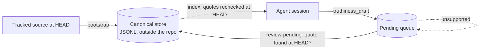

# Truthiness

Project memory for coding agents that shows only notes whose quote still exists at the current `HEAD`. Every note is pinned to a verbatim quote from a tracked file. At session start, after any commit, Truthiness re-reads each note's quote at the new `HEAD`: notes whose quote is still there carry forward, and notes whose quote is gone are withheld.

Agent memory goes stale silently: a note says `parse_config()` lives in `config.py`, someone moves it, and the next session still believes the note. Truthiness never carries a note across revisions on trust, so a stale note is withheld instead of steering the agent. Proposals are reviewed against committed source the moment the agent submits them; nothing waits for the session to end.



| Rule | Effect |
| --- | --- |
| Notes need evidence at the current revision | After a commit, each note's quote is re-read at `HEAD`. Drifted notes stop steering. Notes needing semantic judgement carry forward only if `TRUTHINESS_REVIEWER` accepts them again. |
| The agent cannot write memory directly | A submitted proposal publishes only if `review-pending` verifies it against committed source; the rest stays in the pending queue. |
| Startup context is bounded | At most 60 lines and 1,200 tokens; on-demand lookup covers the rest. |
| Axioms need an operator | Standing rules publish only through `publish-authorized` with an approval file. |

## Quick start with OMP

1. Install the CLI:

   ```sh
   git clone https://github.com/alchimestre/truthiness && cd truthiness && bun link
   ```

2. Load the hook in every repository by adding it to `~/.omp/agent/config.yml`:

   ```yaml
   extensions:
     - /path/to/truthiness/.omp/hooks/pre/truthiness.ts
   ```

3. Start `omp` in any git repository with a clean working tree. The first session seeds memory from declarations and headings at `HEAD`, then injects the startup index.

Each repository gets its own store under `${XDG_STATE_HOME:-~/.local/state}/truthiness/<repo>-<hash>/`. Inside this checkout the hook loads without step 2.

| In a session | Effect |
| --- | --- |
| `/truthiness off` / `on` / `status` | Disable or restore startup context, edit warnings and drafting for this session. |
| `truthiness_draft` tool | Submit new notes as JSONL store records with secrets removed. Notes supported by committed source publish now; the rest stay pending. |
| `edit` or `write` on a file a note quotes | Adds a reminder to re-read that file before relying on its notes. An edit with no readable path gets the reminder too. Does not block. |

## Benchmark

Five hard SWE-bench Verified tasks from Sphinx (`1-4 hours` and `>4 hours`), `claude-opus-5-5`, three runs per arm, 45 graded sessions per experiment. Arms:

- **none**: no memory.
- **flat**: notes from earlier tasks, shown as-is.
- **gated**: the same notes, shown only if their quote still exists at the task's base commit. The benchmark harness did that recheck; the product now does the same at session start.

With notes collected from earlier sessions:

| Arm | Resolved | Input tokens | USD |
| --- | --- | --- | --- |
| none | 11/15 | 1,059k | 2.53 |
| flat | 11/15 | 939k | 2.43 |
| gated | 13/15 | 1,238k | 2.80 |

With 11 stale notes planted on each run's fix path:

| Arm | Stale notes shown | Resolved | Input tokens | Tool calls | Seconds | USD |
| --- | --- | --- | --- | --- | --- | --- |
| none | 0/33 | 12/15 | 1,074k | 139 | 1,309 | 2.57 |
| flat | 33/33 | 12/15 | 1,347k | 143 | 1,155 | 2.72 |
| gated | 0/33 | 12/15 | 835k | 121 | 931 | 2.25 |

The gate withheld every planted stale note. Resolution showed no measurable difference in either experiment: all arm differences come from two tasks, and five tasks cannot reach p < 0.05 on a sign test (minimum two-sided p is 0.0625). Cost is mixed: with organic notes, gated used 17 % more input and 11 % more USD than no memory; with planted stale notes, gated used 38 % less input than flat. One session per arm and task, so read cost as a direction, not a result. The measured benefit is that stale notes never reached the agent.

## CLI reference

| Command | Does |
| --- | --- |
| `truthiness bootstrap STORE` | Once per `HEAD`: add missing declaration and heading notes, then recheck existing notes' quotes. |
| `truthiness index STORE SCOPE REVISION TOKENIZER` | Print the startup index. Empty `SCOPE` when the task is unknown. |
| `truthiness query STORE TOKENIZER` | Answer one JSON query from stdin (`id`, `sparse`, `flat` or `graph` mode) within a token budget. |
| `truthiness anchors STORE` | Prints `{"paths":[...]}`: repository-relative paths quoted by live claims. Exit 1 and no JSON on error. |
| `truthiness stage PENDING_FILE` | Save a JSONL batch from stdin to the pending queue. |
| `truthiness review-pending STORE PENDING_FILE` | Verify a staged batch against `HEAD`, publish what holds, print `{"published": N, "pending": M}`. Leaves the staged file unchanged. |
| `truthiness publish STORE DIGEST` | Publish a reviewed batch from stdin; `DIGEST` is the SHA-256 of the reviewed bytes. |
| `truthiness publish-authorized STORE APPROVAL_FILE` | Operator only: publish axioms with an approval file holding `digest` and `authorityObservationIDs`. |
| `truthiness axioms STORE SCOPE` | Print current axioms for a scope. |
| `truthiness validate STORE` | Validate the store. |

Look up one note:

```sh
echo '{"mode":"id","id":"CLAIM_ID","scope":"repo","revision":"REVISION"}' | truthiness query "$STORE" .omp/truthiness-tokenizer.sh
```

The tokenizer is any executable that reads stdin and prints a token count. The bundled `.omp/truthiness-tokenizer.sh` counts 3 bytes per token. Overcounting is safe and may omit a few entries; undercounting can exceed the budget.

## Review

`review-pending` publishes a note only when every anchor has a matching excerpt in the committed file at `HEAD`. Exact source quotes pass without a model. Anything else needs a semantic reviewer, set with `TRUTHINESS_REVIEWER`. Checks, corrections to existing notes and axioms never pass this route.

The reviewer reads one JSON object on stdin and prints a JSON array of supported candidate IDs:

```json
{"rubric":"...","candidates":[{"id":"...","text":"...","scope":"...","anchors":[{"path":"...","symbol":"..."}],"excerpts":[{"path":"...","text":"..."}]}],"sources":[{"path":"...","text":"..."}]}
```

`sources` holds complete committed files. Candidates stay pending when their source contains a detectable secret, the request exceeds 16 KiB, or the reviewer returns no valid decision. The secret scan is not exhaustive, so use a local reviewer if source must not leave the machine. `.omp/truthiness-reviewer.sh` is an OMP-backed reviewer; `TRUTHINESS_OMP_REVIEW_MODEL` picks its model.

## Configuration

| Variable | Default |
| --- | --- |
| `TRUTHINESS_COMMAND` | `src/cli.ts` in this checkout |
| `TRUTHINESS_STORE` | `$XDG_STATE_HOME/truthiness/<repo>-<hash>/canonical.jsonl` |
| `TRUTHINESS_PENDING` | `$XDG_STATE_HOME/truthiness/<repo>-<hash>/pending` |
| `TRUTHINESS_TOKENIZER` | `.omp/truthiness-tokenizer.sh` |
| `TRUTHINESS_REVIEWER` | unset: only exact quotes publish |
| `TRUTHINESS_BOOTSTRAP` | on; `off` skips seeding and the startup recheck |

## Limits

- Keep the store and pending queue outside the checkout. They are protected by the OS account only: a session with filesystem access can still write to the store directly.
- The startup index loads only on a clean working tree, because uncommitted edits make quotes unverifiable.
- Unresolved batches stay pending and are never replayed at startup.

## Development

```sh
bun test
```
