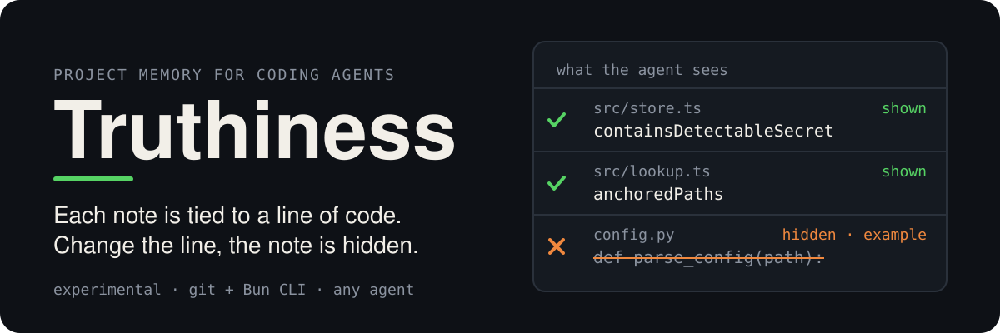

<p align="center">
  
</p>

Git-backed memory for coding agents.

Experimental · [MIT](LICENSE)

[Core flow](#core-flow) · [Install](#install) · [Agent setup](#connect-your-agent) · [Reference](#reference)

## Core flow

<p align="center">
  
</p>

## Install

Requires [Git](https://git-scm.com) and [Bun](https://bun.sh) 1.4.4.

```sh
bun add -g truthiness
```

Check that `bun pm bin -g` prints a directory on your `PATH` so you can run `truthiness` by name.

Print the installed package directory:

```sh
bun -e 'import { realpathSync } from "node:fs"; import { dirname } from "node:path"; console.log(dirname(dirname(realpathSync(process.argv[1]))));' "$(bun pm bin -g)/truthiness"
```

Use that directory in place of `/path/to/truthiness` below.

## Connect your agent

Add your hook, then start a session in a Git repo with no uncommitted changes outside `.truthiness/`.

### OMP

Add the hook to `~/.omp/agent/config.yml`:

```yaml
extensions:
  - /path/to/truthiness/.omp/hooks/pre/truthiness.ts
```

Session commands: `/truthiness status`, `/truthiness off`, `/truthiness on`.

### Claude Code

Add to `~/.claude/settings.json`:

```json
{
  "hooks": {
    "SessionStart": [{ "hooks": [{ "type": "command", "command": "/path/to/truthiness/src/hook.ts session-start" }] }],
    "PostToolUse": [{ "matcher": "Edit|MultiEdit|Write|NotebookEdit", "hooks": [{ "type": "command", "command": "/path/to/truthiness/src/hook.ts post-edit" }] }]
  }
}
```

### Codex

Add to `~/.codex/hooks.json`:

```json
{
  "hooks": {
    "SessionStart": [{ "hooks": [{ "type": "command", "command": "/path/to/truthiness/src/hook.ts session-start" }] }],
    "PostToolUse": [{ "matcher": "apply_patch", "hooks": [{ "type": "command", "command": "/path/to/truthiness/src/hook.ts post-edit" }] }]
  }
}
```

## Reference

<details>
<summary>Settings</summary>

Commit `.truthiness/canonical.jsonl` with your code. Recheck results go to `canonical.rechecks.jsonl` beside it; unless Git already ignores that file, Truthiness adds `*.rechecks.jsonl` to `.truthiness/.gitignore`, so a custom `TRUTHINESS_STORE` needs that rule added by hand. A fresh clone rechecks at its first startup. Pending drafts stay in the Git directory, outside version control.

| Variable | Default |
| --- | --- |
| `TRUTHINESS_STORE` | `.truthiness/canonical.jsonl` at the repository root |
| `TRUTHINESS_PENDING` | `truthiness/pending` in the Git directory |
| `TRUTHINESS_COMMAND` | [`src/cli.ts`](src/cli.ts) |
| `TRUTHINESS_TOKENIZER` | [`scripts/truthiness-tokenizer.sh`](scripts/truthiness-tokenizer.sh) |
| `TRUTHINESS_BOOTSTRAP` | On; `off` skips seeding and rechecking the store at startup |

</details>

<details>
<summary>Try the CLI without a hook</summary>

Run in a committed Git repository. The store is temporary.

```sh
STORE=$(mktemp -d)/store.jsonl
TOKENIZER=/path/to/truthiness/scripts/truthiness-tokenizer.sh
truthiness bootstrap "$STORE"
```

```sh
truthiness index "$STORE" "" "$(git rev-parse HEAD)" "$TOKENIZER"
```

</details>

<details>
<summary>Draft notes and configure a reviewer</summary>

Draft one fact per note. Set `REVISION` to the last commit that changed files outside `.truthiness/`:

```sh
git --no-replace-objects log -1 --format=%H -- ':(top)' ':(top,exclude).truthiness'
```

Replace `REVISION` in this example with that hash:

```jsonl
{"id":"retry-limit","kind":"claim","text":"src/config.ts: export const RETRY_LIMIT = 3;","scope":"repo","anchors":[{"path":"src/config.ts"}],"check":null,"recorded_at":"2026-11-22T18:00:00Z","recorded_by":"agent"}
{"id":"retry-limit-source","kind":"observation","content":"export const RETRY_LIMIT = 3;","source_ref":"REVISION:src/config.ts","captured_at":"2026-11-22T18:00:00Z","context":{"revision":"REVISION","source_event_id":"retry-limit-source","check_session":"agent"},"recorded_at":"2026-11-22T18:00:00Z","recorded_by":"agent"}
{"id":"retry-limit-evidence","kind":"evidence_for","from":"retry-limit-source","to":"retry-limit","rationale":"Quoted line","assessment":{"outcome":"supports","scope":"repo","revision":"REVISION"},"recorded_at":"2026-11-22T18:00:00Z","recorded_by":"agent"}
```

Submit drafts with `truthiness_draft` in OMP or `src/hook.ts draft < notes.jsonl` in Claude Code and Codex. Remove secrets before submitting; the built-in scan is incomplete.
One-line quotes must be unique in their file; a duplicated line stays pending as `ambiguous_quote`.

| Draft | Result |
| --- | --- |
| Exact quote: `claim.text` is `path: line`, with one anchor, no symbol and scope `repo` | Publishes without a model if the entire line matches committed source (ignoring surrounding whitespace). |
| Statement in your own words | Stays pending unless the [reviewer](#reviewer) confirms it from committed source. |

Use unique record IDs. Each anchor needs its own observation. Keep `claim.check` null and set `evidence_for.assessment.scope` to the claim's scope. If the source revision changes before review, refresh the draft.

When a claim says more than its one-line quote, Truthiness also records a hash of the block that line opens: its indented body, or the section under a Markdown heading. When that block changes, the claim is hidden until it is redrafted, even if the quoted line is still present. A bare `path: line` quote is unaffected.

### Reviewer

Set `TRUTHINESS_REVIEWER` to an executable that reads JSON and returns a JSON array of approved IDs within 30 seconds. The request includes whole committed files; use a local model if code must stay on the machine.

[`scripts/truthiness-reviewer.sh`](scripts/truthiness-reviewer.sh) wraps a text-completion command. Use a command without tools or filesystem access: the prompt contains untrusted source.

```sh
export TRUTHINESS_REVIEWER=/path/to/truthiness/scripts/truthiness-reviewer.sh
export TRUTHINESS_REVIEW_COMMAND=llm
```

</details>

<details>
<summary>CLI commands</summary>

| Command | Use |
| --- | --- |
| `truthiness bootstrap STORE` | Seed and recheck notes against the latest source commit. Paths with the `truthiness` attribute unset in `.gitattributes` (`bench/** -truthiness`) are not seeded. |
| `truthiness index STORE SCOPE REVISION TOKENIZER` | Print the startup index, with a count of stale notes it hides. Use `""` for an unscoped index. |
| `truthiness stale STORE SCOPE REVISION` | Print a refresh draft for the first stale note. Edit its quoted line, then stage it. Prints nothing when none is stale. |
| `truthiness query STORE TOKENIZER` | Look up notes via a JSON request on stdin (`id`, `sparse`, `flat` or `graph`). |
| `truthiness anchors STORE` | List files quoted by valid notes. Re-read them before editing. |
| `truthiness stage PENDING_FILE` | Stage a JSONL draft from stdin. |
| `truthiness review-pending STORE PENDING_FILE` | Publish supported drafts and return reason codes for the rest. |
| `truthiness validate STORE` | Check the store for errors. |
| `truthiness axioms STORE SCOPE` | List standing rules for a scope. |
| `truthiness publish-authorized STORE APPROVAL_FILE` | Publish standing rules from stdin with an approval file. |
| `truthiness pending STORE PENDING_FILE` | Show the strongest pending claim with its reason and quotes, plus the count of the rest. |
| `truthiness pending-approve STORE PENDING_FILE CLAIM_ID` | Publish one pending claim whose quotes still match source. `pending-decline STORE PENDING_FILE CLAIM_ID` moves it to `PENDING_FILE.declined`. |

Look up one note:

```sh
printf '%s\n' '{"mode":"id","id":"NOTE_ID","scope":"repo","revision":"REVISION"}' | truthiness query "$STORE" "$TOKENIZER"
```

`TOKENIZER` reads text on stdin and prints a token count. The bundled script estimates one token per three bytes.

</details>

## Limits

| Limit | What it means |
| --- | --- |
| Matching evidence is not proof of the whole claim | It shows the cited text still exists. |
| No write isolation | An agent with filesystem access can edit the store directly. |

<details>
<summary>Development</summary>

```sh
bun install --frozen-lockfile
```

```sh
bun run typecheck
```

```sh
bun test
```

[SkillOpt](https://microsoft.github.io/SkillOpt/) trials led to actionable feedback on pending notes without changing what gets published. [Harness](scripts/skillopt/).

</details>
