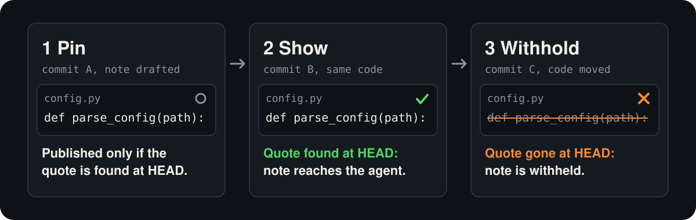

<p align="center">
  
</p>

Truthiness is Git-backed memory for coding agents. It shows agents notes backed by committed evidence and hides notes when that evidence changes.

Experimental · [MIT](LICENSE)

## Install

Requires [Git](https://git-scm.com) and [Bun](https://bun.sh) 1.4.4.

```sh
bun add -g truthiness
```

To locate the installed hook files, resolve the CLI symlink:

```sh
bun -e 'import { realpathSync } from "node:fs"; import { dirname } from "node:path"; console.log(dirname(dirname(realpathSync(Bun.which("truthiness")!))));'
```

Use the printed directory in place of `/path/to/truthiness` below.

## How notes stay current

<p align="center">
  
</p>

## Connect your agent

Start a session in a Git repository with no uncommitted changes outside `.truthiness/`. The hook seeds notes from declarations and Markdown headings, then adds a short index of valid notes to the session.

### OMP

Add the hook to `~/.omp/agent/config.yml`:

```yaml
extensions:
  - /path/to/truthiness/.omp/hooks/pre/truthiness.ts
```

Use `/truthiness status` to check the hook, `/truthiness off` to disable it for the session, and `/truthiness on` to re-enable it.

### Claude Code

Add to `~/.claude/settings.json`:

```json
{
  "hooks": {
    "SessionStart": [{ "hooks": [{ "type": "command", "command": "/path/to/truthiness/src/hook.ts session-start" }] }],
    "PostToolUse": [{ "matcher": "Edit|MultiEdit|Write|NotebookEdit", "hooks": [{ "type": "command", "command": "/path/to/truthiness/src/hook.ts post-edit" }] }]
  }
}
```

### Codex

Add to `~/.codex/hooks.json`:

```json
{
  "hooks": {
    "SessionStart": [{ "hooks": [{ "type": "command", "command": "/path/to/truthiness/src/hook.ts session-start" }] }],
    "PostToolUse": [{ "matcher": "apply_patch", "hooks": [{ "type": "command", "command": "/path/to/truthiness/src/hook.ts post-edit" }] }]
  }
}
```

### Settings

Commit `.truthiness/canonical.jsonl` with your code. Pending drafts stay in the Git directory, outside version control.

| Variable | Default |
| --- | --- |
| `TRUTHINESS_STORE` | `.truthiness/canonical.jsonl` at the repository root |
| `TRUTHINESS_PENDING` | `truthiness/pending` in the Git directory |
| `TRUTHINESS_COMMAND` | [`src/cli.ts`](src/cli.ts) |
| `TRUTHINESS_TOKENIZER` | [`scripts/truthiness-tokenizer.sh`](scripts/truthiness-tokenizer.sh) |
| `TRUTHINESS_BOOTSTRAP` | On; `off` skips seeding and rechecking the store at startup |

## Try the CLI without a hook

In a committed Git repository, generate an index. This writes notes to a temporary store, not your repository.

```sh
STORE=$(mktemp -d)/store.jsonl
TOKENIZER=/path/to/truthiness/scripts/truthiness-tokenizer.sh
truthiness bootstrap "$STORE"
```

```sh
truthiness index "$STORE" "" "$(git rev-parse HEAD)" "$TOKENIZER"
```

The output starts with `# Truthiness startup index`. Each entry points to a note you can look up by ID.

## Writing notes

Commit the code first. Submit one checkable fact per note as three JSONL records: a claim, an observation (the quote) and an `evidence_for` link. Set `REVISION` to the last commit that changed files outside `.truthiness/`:

```sh
git --no-replace-objects log -1 --format=%H -- ':(top)' ':(top,exclude).truthiness'
```

Replace `REVISION` in this example with that hash:

```jsonl
{"id":"retry-limit","kind":"claim","text":"src/config.ts: export const RETRY_LIMIT = 3;","scope":"repo","anchors":[{"path":"src/config.ts"}],"check":null,"recorded_at":"2026-11-22T18:00:00Z","recorded_by":"agent"}
{"id":"retry-limit-source","kind":"observation","content":"export const RETRY_LIMIT = 3;","source_ref":"REVISION:src/config.ts","captured_at":"2026-11-22T18:00:00Z","context":{"revision":"REVISION","source_event_id":"retry-limit-source","check_session":"agent"},"recorded_at":"2026-11-22T18:00:00Z","recorded_by":"agent"}
{"id":"retry-limit-evidence","kind":"evidence_for","from":"retry-limit-source","to":"retry-limit","rationale":"Quoted line","assessment":{"outcome":"supports","scope":"repo","revision":"REVISION"},"recorded_at":"2026-11-22T18:00:00Z","recorded_by":"agent"}
```

Submit drafts with `truthiness_draft` in OMP or `src/hook.ts draft < notes.jsonl` in Claude Code and Codex. Remove secrets before submitting; the built-in scan is incomplete.

| Draft | Result |
| --- | --- |
| Exact quote: `claim.text` is `path: line`, with one anchor, no symbol and scope `repo` | Publishes without a model if the entire line matches committed source (ignoring surrounding whitespace). |
| Statement in your own words | Stays pending unless the [reviewer](#reviewer) confirms it from committed source. |

Use unique record IDs. Each anchor needs its own observation. Keep `claim.check` null and set `evidence_for.assessment.scope` to the claim's scope. If the source revision changes before review, refresh the draft.

## CLI reference

| Command | Use |
| --- | --- |
| `truthiness bootstrap STORE` | Seed and recheck notes against the latest source commit. |
| `truthiness index STORE SCOPE REVISION TOKENIZER` | Print the startup index. Use `""` for an unscoped index. |
| `truthiness query STORE TOKENIZER` | Look up notes via a JSON request on stdin (`id`, `sparse`, `flat` or `graph`). |
| `truthiness anchors STORE` | List files quoted by valid notes. Re-read them before editing. |
| `truthiness stage PENDING_FILE` | Stage a JSONL draft from stdin. |
| `truthiness review-pending STORE PENDING_FILE` | Publish supported drafts and return reason codes for the rest. |
| `truthiness validate STORE` | Check the store for errors. |
| `truthiness axioms STORE SCOPE` | List standing rules for a scope. |
| `truthiness publish-authorized STORE APPROVAL_FILE` | Publish standing rules from stdin with an approval file. |

Look up one note:

```sh
printf '%s\n' '{"mode":"id","id":"NOTE_ID","scope":"repo","revision":"REVISION"}' | truthiness query "$STORE" "$TOKENIZER"
```

`TOKENIZER` reads text on stdin and prints a token count. The bundled script estimates one token per three bytes.

### Reviewer

Set `TRUTHINESS_REVIEWER` to an executable that reads a JSON request and returns a JSON array of approved candidate IDs within 30 seconds. The request includes whole committed source files. Oversized requests, detected secrets and invalid replies leave notes pending.

[`scripts/truthiness-reviewer.sh`](scripts/truthiness-reviewer.sh) wraps a text-completion command. Use a command with no tools or file access; the prompt contains untrusted source. Use a local model if code must not leave the machine.

```sh
export TRUTHINESS_REVIEWER=/path/to/truthiness/scripts/truthiness-reviewer.sh
export TRUTHINESS_REVIEW_COMMAND=llm
```

## Limits

| Limit | What it means |
| --- | --- |
| Committed evidence only | Hooks skip startup on a dirty source tree. Store-only changes do not advance the source revision. |
| Evidence is not proof of the whole claim | A matching quote shows that the cited text still exists. Pending notes do not appear at startup. |
| No write isolation | An agent with filesystem access can edit the store directly. |

## Development

```sh
bun install --frozen-lockfile
```

```sh
bun run typecheck
```

```sh
bun test
```

We used [SkillOpt](https://microsoft.github.io/SkillOpt/) to test changes to the agent instructions. One result shipped in the draft tool: tell the agent what to fix on a pending note without changing which notes qualify for publication. [Truthiness SkillOpt harness](scripts/skillopt/).
